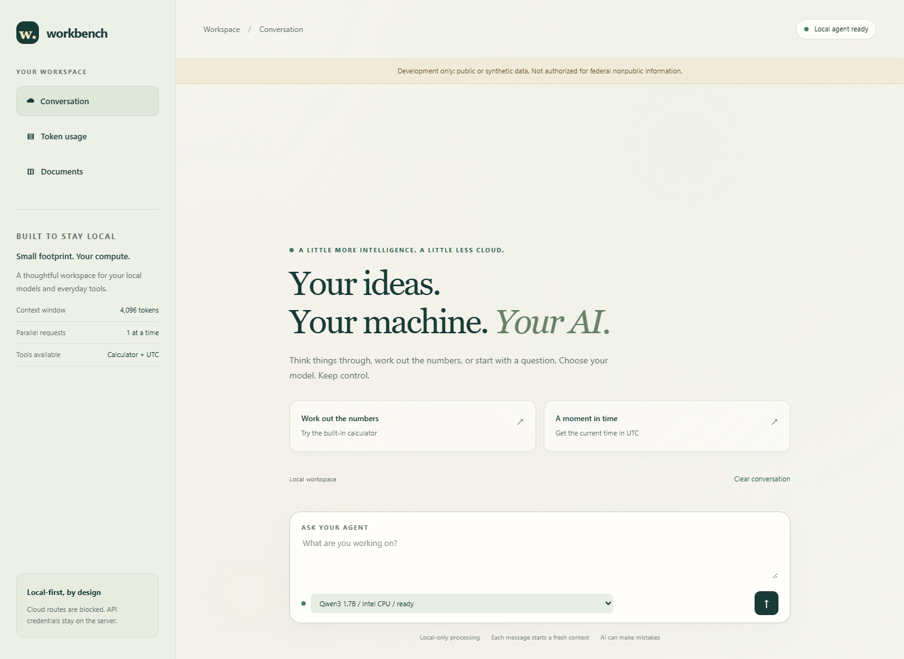
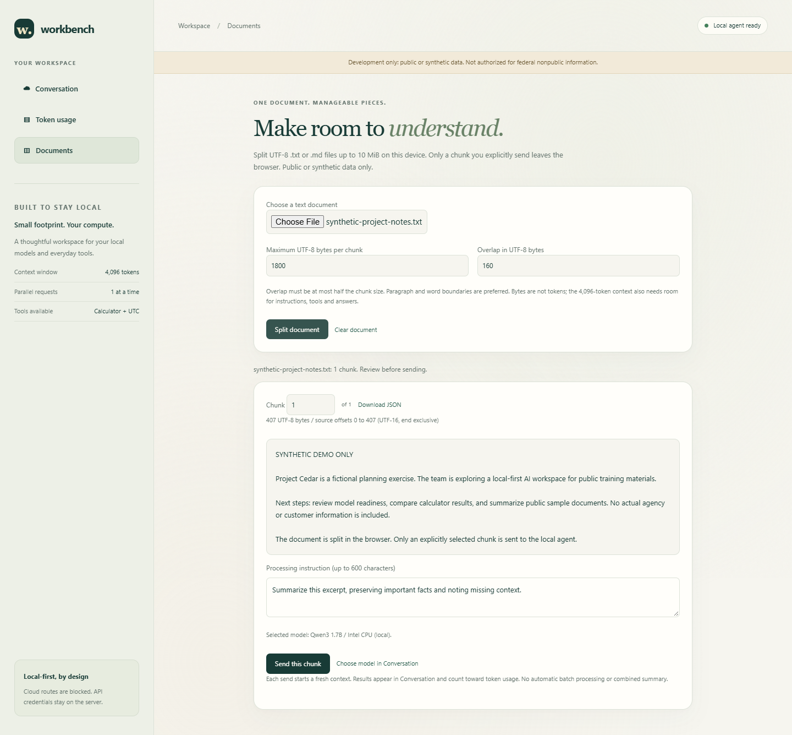
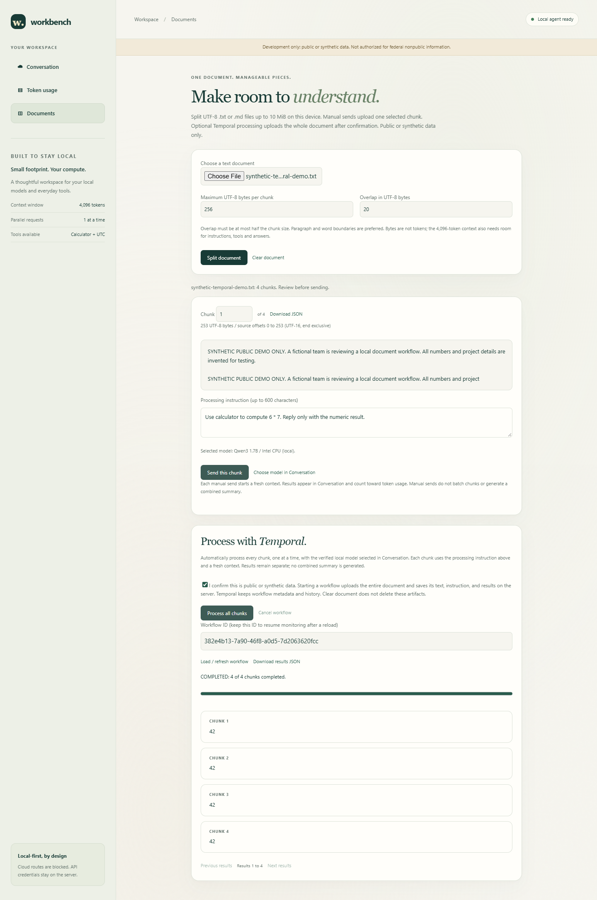
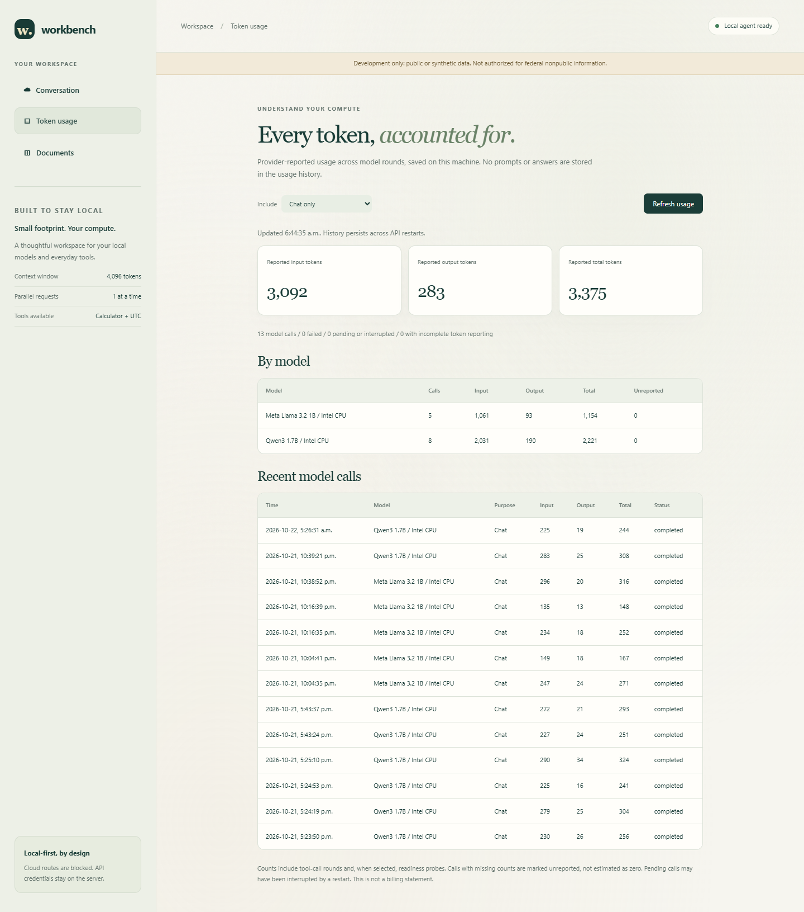

## Architecture

```text
Browser / authenticated client
       |
127.0.0.1:8000 -> fixed-destination ingress (same agent image)
       |
FastAPI agent -> LiteLLM gateway -> Ollama -> qwen3:4b
                        |
                opt-in external APIs

Azure Container Registry Basic -> image distribution only
Intel PC                     -> all local compute and model storage
```

The target is Ubuntu 24.04 LTS on Intel x86-64 with an SSD, 16 GB RAM
(32 GB preferred), and 100 GB free storage. Install
[Docker Engine and Compose v2](https://docs.docker.com/engine/install/ubuntu/).
All three images target `linux/amd64`; no GPU is required.

> [!WARNING]
> Development only: public or synthetic data. This system and its model candidates
> are not authorized for federal nonpublic information. Digest and inference
> verification are technical development checks, not agency approval, an ATO,
> FedRAMP authorization, or FIPS validation. The notice is not a data-loss
> prevention mechanism; do not enter nonpublic data.

## Screenshots

Captured from the running local development interface. Model readiness and token
counts reflect this development machine at capture time and will vary by setup.
The document preview contains synthetic demonstration text only.

### Conversation

Choose a verified local model and start a conversation, or try the calculator
and UTC-time tools.



### Documents

Split a text document in the browser, review the selected chunk, and choose
whether to send it to the local agent. The example below was split locally
without sending it for inference.



### Temporal document workflow

Process all chunks sequentially, monitor durable progress, and download per-chunk
results. This live synthetic example completed four calculator requests.



### Token usage

Inspect provider-reported input, output, and total tokens, with per-model
breakdowns and recent call history. This view shows chat calls only.



## Local model candidates

The local allowlist includes [Qwen3 4B](https://ollama.com/library/qwen3:4b),
[Qwen3 1.7B](https://ollama.com/library/qwen3:1.7b),
[Microsoft Phi-4 Mini 3.8B](https://ollama.com/library/phi4-mini:3.8b),
[Meta Llama 3.2 1B](https://ollama.com/library/llama3.2:1b), and
[Meta Llama 3.2 3B](https://ollama.com/library/llama3.2:3b).
Each model has its own digest approval and readiness check. Read each model's
license before use; they do not all have the same license.
The gateway requests CPU inference with memory-mapped weights, disables thinking for Qwen3,
and sets Ollama's context to 4,096 tokens. Only one model is loaded at a time,
even when several models are ready for selection. Hardware compatibility and acceptable
latency must still pass the acceptance checks on your actual Intel PC.
The model tag alone is not trusted: readiness requires a manually approved full
SHA-256 digest, advertised tool capability, and a successful end-to-end calculator
inference through LiteLLM.

In the isolated development check, Qwen3 1.7B passed real calculator and UTC-tool
requests through the gateway. Llama 3.2 3B was downloaded and its manifest digest
matched, but it failed the structured tool-inference check, including a malformed
tool call emitted as ordinary text. It is disabled in the supplied catalog; its
weights are retained. Do not enable it until it passes the same readiness checks
with a reviewed runtime. Microsoft Phi-4 Mini and Meta Llama 3.2 1B are additional
development candidates with independent digest approvals. Their downloads total
approximately 3.8 GB; runtime memory usage is higher. They become selectable only
after passing the same readiness checks. Microsoft Phi uses an MIT license;
Meta Llama uses the Llama 3.2 Community License, not an MIT or Apache license.
Review the applicable model terms before use.
In the Microsoft/Meta development check, Llama 3.2 1B passed the structured
calculator round trip and reported token usage. Phi-4 Mini advertised tools but
failed that round trip; it remains listed but unselectable while verification
fails. Do not bypass readiness to enable a failed candidate.
These results do not authorize any model for agency data.

## Prepare configuration

### Separate federal review hold

The standalone `compose.review.yaml` deployment is a locked review boundary
for federal nonpublic information, explicitly excluding CUI and classified data.
It is not an authorized processing environment. Do not submit actual nonpublic
information, even to test blocking. Use only synthetic test inputs.

Run it separately, not as an overlay on `compose.yaml`. It uses a different
Compose project, agent image, and private internal network. No host ports are
published; review probes run inside the container, not through the browser.
It has no Ollama or gateway service, model-volume access, usage database mount,
or outbound inference client. The container runs as the existing nonroot user,
with a read-only filesystem, dropped capabilities, and bounded local logs.
The public/synthetic development service on port 3001 or 8000 is unchanged;
these controls do not protect data entered into that separate service.

Generate two distinct review-only secrets in your shell and start the review
service (the secrets satisfy application startup configuration, not user identity
or agency authorization):

```bash
export REVIEW_AGENT_API_KEY="$(python3 -c 'import secrets; print(secrets.token_urlsafe(32))')"
export REVIEW_GATEWAY_KEY="$(python3 -c 'import secrets; print(secrets.token_urlsafe(32))')"
docker compose -f compose.review.yaml up -d --build
docker compose -f compose.review.yaml exec agent .venv/bin/python -c \
  "import urllib.request; print(urllib.request.urlopen('http://127.0.0.1:8000/').read().decode())"
```

With `DEPLOYMENT_PROFILE=federal-review`:

* The home page returns review-hold JSON instead of the chat/document UI.
* All requests except GET `/`, `/healthz`, and `/readyz` receive HTTP 403 before
  request-body buffering or handler execution. A bearer token cannot override
  the hold, and new routes are blocked by default. WebSockets are closed.
* No runtime, readiness inference loop, outbound HTTP client, or usage store starts.
* Cloud enablement fails configuration validation, and gateway startup is refused.
* `/healthz` reports liveness, but `/readyz` always returns HTTP 503.
* Denial logs use fixed messages without prompts, headers, query strings or keys.
  These local logs are not an approved, tamper-resistant audit system.

The ASGI boundary avoids reading request bodies in application code; it cannot
prevent bytes reaching the host, container network stack, HTTP server buffers,
or an upstream proxy. Do not use it as a sensitive-data disposal mechanism.
It does not classify content or detect all nonpublic information.
Tests use a fictional Project Cedar training note, not real agency data:

```bash
uv run pytest tests/test_federal_review.py tests/test_local_ui.py
```

You can also demonstrate the live hold with this synthetic request inside the
container. Expect HTTP 403 with `processing_enabled: false`, not a model answer.
This example uses a Bash here-document on the target Ubuntu host:

```bash
docker compose -f compose.review.yaml exec -T agent .venv/bin/python - <<'PY'
import json
import urllib.error
import urllib.request

body = json.dumps({
    "model": "local-qwen3-small",
    "message": "SYNTHETIC ONLY: Fictional Project Cedar training exercise. No actual agency data."
}).encode()
request = urllib.request.Request(
    "http://127.0.0.1:8000/agent",
    data=body,
    headers={"Content-Type": "application/json"}
)
try:
    response = urllib.request.urlopen(request, timeout=5)
except urllib.error.HTTPError as error:
    response = error
assert response.status == 403
print(response.status, response.read().decode())
PY
```

There is intentionally no approval flag or route to unlock processing. Before
any nonpublic-data deployment, the agency must determine applicable requirements
and approve the system boundary. Integrate individually authenticated agency
identity, MFA and roles; agency authorization and session controls; approved
transport and storage protection with managed keys; controlled egress; a reviewed
model/software supply chain; approved audit collection and retention; and incident,
patching, backup and recovery procedures. Applicable cryptographic validation,
privacy, records-management and security assessment requirements need agency review.
Do not assume FedRAMP applies or that it alone authorizes this local system.
Removing the hold requires a separately reviewed implementation, not changing
the deployment profile to development. CUI or classified use requires a separate
scope and authorization process.

### Development configuration

On the Intel PC, copy `.env.example` to `.env`. Generate two different secrets:

```bash
cp .env.example .env
python3 -c "import secrets; print(secrets.token_urlsafe(32)); print(secrets.token_urlsafe(32))"
chmod 600 .env
```

Set `AGENT_API_KEY` and `LITELLM_MASTER_KEY` to those values.
Leave `ALLOW_CLOUD=false`. Do not commit `.env` or put credentials in images.
Docker administrators can inspect container environment variables; use a trusted
single-host deployment and rotate secrets when necessary.

For a local source build, leave `ACR_LOGIN_SERVER` empty:

```bash
docker compose build
```

## Download and approve local development models

Model weights live in the named `ollama-models` volume at `/root/.ollama`,
not in the ACR image. The daemon needs temporary outbound access to download them:

```bash
docker compose -f compose.yaml -f compose.bootstrap.yaml up -d ollama
docker compose exec ollama ollama pull qwen3:4b
docker compose exec ollama ollama pull qwen3:1.7b
docker compose exec ollama ollama pull llama3.2:3b
docker compose exec ollama ollama pull phi4-mini:3.8b
docker compose exec ollama ollama pull llama3.2:1b
docker compose exec ollama ollama show qwen3:4b
docker compose run --rm --no-deps --entrypoint python gateway \
  -c "import urllib.request; print(urllib.request.urlopen('http://ollama:11434/api/tags').read().decode())"
```

Review the model's license, source, quantization, and downloaded full digest.
Set `LOCAL_MODEL_DIGEST` in `.env` using the full `digest` field for
`qwen3:4b` from `/api/tags` (with or without the `sha256:` prefix).
Approve only weights you intend to run.
The `ollama list` display truncates the digest, so do not use that abbreviated ID.
Alternatively, set `approved_digest` on each local route in `models.yaml`.
This per-route value takes precedence over the legacy `LOCAL_MODEL_DIGEST`,
which applies only to Qwen3 4B. All other local models require their own
per-route approvals; none inherits Qwen3 4B's approval.
Disable models you do not intend to install. At least one local route must remain enabled.

Remove download egress by recreating Ollama with only the base configuration:

```bash
docker compose up -d --force-recreate ollama
docker compose up -d gateway agent ingress
docker compose logs -f agent
```

The inference network is internal. Neither Ollama, LiteLLM nor the agent publishes
a host port. A small ingress service publishes only to loopback and forwards
allowlisted routes to the fixed agent service. It reuses the agent image, receives
no provider credentials, and preserves Host/Origin and REST authentication.
Its second bridge network allows host access without giving the agent, gateway,
or Ollama an outbound route in local-only mode. This avoids relying on published
ports of an internal-only container, which did not work on the development
Docker Engine. Set `AGENT_PORT` to another unused port if 8000 is occupied.
Do not leave the bootstrap
overlay active for normal operation. Image and model downloads require internet;
normal local inference does not.

## Use the UI and API

Open <http://localhost:8000> (or your configured `AGENT_PORT`). The local UI loads models and usage automatically;
there is no token-entry or connection step. API credentials stay on the server,
not in browser memory or storage. The UI never loads fonts, scripts, images or
styles from a third-party CDN. It uses inline styles rather
than a Tailwind CDN to preserve offline/local-only behavior.
Each message is a fresh context; displayed conversation history is not resent.
Only verified models can be selected. Status refreshes every 15 seconds.
Clear conversation removes the displayed messages without clearing usage history.

### Split text documents

Open the Documents tab and choose a UTF-8 `.txt` or `.md` file up to 10 MiB.
Set the maximum chunk size (256 to 2,400 UTF-8 bytes) and overlap (at most
half that size), then select Split document. Defaults are 1,800 bytes and
160 bytes of overlap. The splitter prefers paragraph or whitespace boundaries
near the end of each chunk and never splits a Unicode code point. Bytes are
not token counts; these conservative limits leave context space but do not
guarantee that every model can process every excerpt.

Preview one chunk by number, download all chunks as JSON, or enter an
instruction and send the selected chunk to the model chosen in Conversation.
Only verified models can receive chunks. Each send starts a fresh context;
answers appear in Conversation and usage is recorded as chat. There is no
automatic batch processing in this manual path or combined document summary. If cloud routes
are explicitly enabled, sending to a cloud model sends that excerpt to its provider.
Request-size checks include JSON escaping; reduce the chunk size if rejected.

Splitting and preview happen in browser memory without uploading the document.
Local previews are not persisted by the app and disappear on refresh.
Clear document removes the loaded document, not downloaded JSON or messages
already sent. JSON includes the original filename, chunk text, UTF-8 byte
lengths, and zero-based UTF-16 source offsets (end exclusive). Overlapping
chunks intentionally repeat text. Binary, UTF-16, invalid UTF-8, and empty
documents are rejected. Only public or synthetic documents are permitted.

### Automatic document processing with Temporal

The optional local Temporal stack adds durable, sequential processing to the
Documents tab. It is disabled by default and is available only in development
mode. It never enables processing in the federal review hold.

After configuring the normal development secrets and approving a local model,
start the stack:

```bash
docker compose -f compose.yaml -f compose.temporal.yaml up -d --build
docker compose -f compose.yaml -f compose.temporal.yaml logs -f document-worker
```

Open the Documents tab, split a public or synthetic UTF-8 document, and enter a
processing instruction in the chunk preview. Choose a verified local model in
Conversation, confirm the persistence notice, then select Process all chunks.
The browser uploads the whole document once. The server validates and splits it
again; its chunk count is authoritative. The 10 MiB document limit still applies,
with a maximum of 10,000 chunks. Increase the chunk size or reduce overlap if the
chunk count exceeds that limit. JSON uploads are bounded to 64 MiB to allow for
escaping; ordinary agent requests remain limited to 16 KiB.

Keep the workflow ID shown in the tab. Use Load / refresh workflow to resume
monitoring after a browser reload. Progress refreshes every three seconds while
the workflow runs and identifies the current one-based chunk, for example
"Processing chunk 3 of 20. 2 of 20 chunks completed." The worker reports its actual
chunk index through Temporal heartbeats. Queued work is shown as waiting for a
worker, not as processing; older workers without chunk heartbeats show that the
index is pending until upgraded. Results are paginated, and Download results JSON exports a
snapshot of the completed chunks. Closing the browser or clearing the local
preview does not cancel a workflow. Cancel workflow requests cancellation;
in-flight inference may still finish. Partial results remain available after
failure or cancellation.

Each chunk is processed through the existing authenticated `/agent` endpoint,
using the same readiness checks, tool policy, and usage recording as chat.
Only local models are permitted for automatic processing, even when cloud routes
are enabled. The worker runs one activity at a time across document jobs to
respect the CPU/model concurrency limit. Independent manual/API calls can still
contend with the worker and fail explicitly. Browser chat sending is paused while
the displayed workflow is running.

Temporal receives only job IDs, chunk indexes, and counts, not document text,
instructions, or answers. These contents are stored separately in the local
`document-artifacts` volume; Temporal history and execution state are stored in
`temporal-state`. Both volumes persist across container restarts. Do not remove
either volume while retaining the other and expecting resumable processing.
Clear document does not delete these server artifacts. There is no automatic
retention policy: keep only synthetic/public material, apply a deliberate
retention policy to these volumes, and remove them only after stopping the stack
and confirming no retained jobs or results are needed.

The workflow uses Continue-As-New after every 100 chunks to bound history.
Completed results are saved atomically and reused if an activity encounters the
same chunk again. Inference activities have one attempt, not automatic retries:
a timeout or worker failure might occur after the model has already processed
the chunk. This is not an exactly-once inference guarantee. Inspect failures
before starting a new job, which can repeat inference and usage. An uncertain
submission should be checked using its existing workflow ID before resubmission.
Each chunk starts a fresh context, overlap intentionally repeats text, and no
combined document summary is generated.

The pinned Temporal development server uses SQLite persistence and publishes no
host ports in Compose. The worker, agent, and Temporal communicate only over the
existing private network. This development server is not a production Temporal
deployment and has no agency authorization, multi-user identity, or encryption
at rest supplied by this feature. Do not expose it or use it for nonpublic data.
The existing manual chunk preview and sending path still works without Temporal.

For a separately managed local development server, configure `TEMPORAL_ENABLED`,
`TEMPORAL_ADDRESS`, `TEMPORAL_NAMESPACE`, `TEMPORAL_TASK_QUEUE`,
`DOCUMENT_DATA_PATH`, and `DOCUMENT_AGENT_URL` consistently for the API and worker.
Run the worker with `uv run python -m agent.document_worker`; it requires the
normal agent and gateway configuration and rejects the federal-review profile.
API and worker processes must share the same document directory.

Bearer-authenticated clients can use `GET /document-workflows/config`,
`POST /document-workflows`, `GET /document-workflows/{id}?offset=0&limit=20`,
and `POST /document-workflows/{id}/cancel`. Submission accepts a client-generated
UUID `id`, `name`, UTF-8 `text`, a local `model` ID, `instruction`,
`max_chunk_bytes`, and `overlap_bytes`. Reusing the same ID with the same document
does not start another execution; reusing it for different content is rejected.
Status includes the ID, filename, model, status, total/completed counts, offset,
`current_chunk` (one-based or null), `chunk_state` (queued, processing, cancelling,
or idle), and ordered results containing a one-based chunk index and answer. Result page
sizes are limited to 100.

### Local UI access

The UI uses `/ui-api/models`, `/ui-api/agent`, `/ui-api/usage`, and the
`/ui-api/document-workflows` routes. These routes
accept only loopback Host headers, reject cross-origin browser requests, and
require a matching Origin for submissions and cancellation. Anyone who can access this local
UI can use chat, read usage, and access enabled document jobs and their contents;
these checks are not individual user authentication.
Keep the loopback bindings in Compose and the development server. Do not expose
or forward these UI routes to untrusted users. Direct REST routes still require
the bearer token, including when accessed through the preview proxy.

For API requests, set a shell variable without writing the secret into history:

```bash
read -rsp 'Agent token: ' AGENT_API_KEY; echo
export AGENT_API_KEY
curl -fsS http://localhost:8000/healthz
curl -i http://localhost:8000/readyz
curl -fsS http://localhost:8000/models \
  -H "Authorization: Bearer $AGENT_API_KEY"
curl -fsS http://localhost:8000/agent \
  -H "Authorization: Bearer $AGENT_API_KEY" \
  -H 'Content-Type: application/json' \
  -d '{"model":"local-qwen3","message":"Use calculator to compute 6 * 7."}'
```

| Endpoint   | Authentication | Response |
|------------|----------------|----------|
| `/`        | Public shell   | Chat UI without credentials or model details |
| `/models`  | Bearer token   | `cloud_enabled`, model IDs, policy and verification state |
| `/agent`   | Bearer token   | `{"model":"local-qwen3","answer":"42"}` |
| `/usage`   | Bearer token   | Persistent totals, model breakdown, and latest 20 model calls |
| `/ui-api/*` | Local UI checks | The same model, chat, and usage handlers without browser credentials |
| `/healthz` | Public         | `{"status":"alive"}` while the app runs |
| `/readyz`  | Public         | 200 `{"status":"ready"}` while at least one enabled local model is verified; otherwise 503 |

Readiness verification runs at startup and every five minutes, serialized with
user inference. It exercises the calculator tool and a final model answer.
Before local inference, it allows up to five minutes for a CPU-only, empty-prompt
model warm-up. This loads weights without generating tokens and is not counted as
an inference call. Tool-inference probes and cloud conversations have a
180-second bound after preparation. Local CPU conversations allow up to 15 minutes,
including all model/tool rounds, so a 512-token answer is not cut off by the old
120-second HTTP limit on a slow CPU. User requests recheck the approved model and
warm it before inference, so switching between models works when only one model
is resident. Local preparation and inference share a bounded 20-minute request deadline.
Cold loading and model switching may make the slot unavailable
during verification; no model becomes ready merely by warming up.
External models receive their own probe only when enabled, which can incur API
charges. Readiness expires after the five-minute pause plus one bounded serial
verification cycle and a 30-second scheduling allowance. This accounts for all
enabled routes rather than expiring the first model while later models load.
Inference failures
invalidate the affected model until it passes verification again.
Liveness deliberately does not depend on model readiness, so a cold model does
not cause container restart loops.

## Persistent token usage

The Token usage tab loads automatically through the local UI routes.
Direct requests to `/usage` still require the agent bearer token.
It shows provider-reported input, output, and total tokens across every inference
round, including tool-call rounds. Filter between chat, readiness checks, or both.
Counters represent model calls, not user messages: a tool-assisted message
typically makes two or more model calls.

The agent records call metadata in SQLite at `data/usage.sqlite3` by default,
or at `USAGE_DB_PATH`. Compose persists this directory in the `agent-usage` volume,
including when the container filesystem is read-only. Counts survive process
and container restarts. No prompts, answers, tool arguments, bearer tokens, or
provider credentials are stored in the ledger.

Missing counts remain null and appear as Unreported, not as zero-token
inference. Summary cards sum only reported counts; check the incomplete-call
count before interpreting them. When input and output counts are reported but
the total is omitted, their sum is recorded. These are not estimated token
counts, prices, or a billing statement.

Failed or truncated completions retain reported consumption when available.
Requests rejected before inference do not create model-call records.
An in-flight call is recorded as pending before it reaches the gateway; pending
rows can also represent an interrupted process whose final usage is unknown.
Unavailable usage storage fails explicitly rather than silently dropping
accounting. Do not automatically retry such failures because inference may have
already run.

The ledger retains all call metadata until you apply a retention policy.
Back up SQLite with its backup API, or stop the agent before copying the database
and its WAL files. Protect volume access; storage encryption, tamper-evident
auditing, enterprise identity, and an agency-approved retention policy are not
provided by this development ledger.

```bash
curl -fsS 'http://localhost:8000/usage?scope=chat' \
  -H "Authorization: Bearer $AGENT_API_KEY"
```

## Federal deployment boundary

For U.S. federal nonpublic information, the agency must establish its
[FIPS 199 categorization](https://csrc.nist.gov/pubs/fips/199/final), determine
applicable security and privacy controls, and authorize the deployed system
through its [Risk Management Framework process](https://csrc.nist.gov/pubs/sp/800/37/r2/final).
No CUI does not automatically mean Low impact.
Model provenance, licensing, evaluation evidence, supply-chain controls, agency
AI policy, and any cloud service's specific authorization boundary need review.
The [NIST AI RMF](https://www.nist.gov/itl/ai-risk-management-framework) is risk
guidance, not certification. Verify applicable cryptographic modules through
[NIST CMVP](https://csrc.nist.gov/projects/cryptographic-module-validation-program);
ordinary HTTPS or an Ubuntu installation does not establish FIPS validation.
Do not treat a model digest or a successful calculator test as proof of compliance.

## Enable external models explicitly

1. In `models.yaml`, enable only your intended routes. Adjust model IDs to models
   available to your account. For Azure, set the deployment, HTTPS resource
   endpoint, and supported API version. For a compatible API, set the model and
   HTTPS `/v1` base URL.
2. Set the corresponding provider API key in `.env`.
3. Set `ALLOW_CLOUD=true` in `.env`.
4. Give the inference gateway provider egress without changing agent or Ollama networking:

   ```bash
   docker compose -f compose.yaml -f compose.cloud.yaml up -d --force-recreate gateway agent
   ```

Both the agent and gateway reject cloud aliases when cloud processing is off.
An enabled catalog entry without a credential fails gateway startup explicitly.
Wildcard models, unapproved local models, arbitrary per-request endpoints, and
automatic cloud fallback are not supported. A compatible endpoint is classified
as cloud even if you happen to host it privately.

To return to local-only operation, set `ALLOW_CLOUD=false`, then run:

```bash
docker compose up -d --force-recreate gateway agent
```

This also removes the gateway's egress network. Explicitly selecting a cloud
model sends your current message and tool transcript to that provider.

## Store all three images in ACR Basic

Azure provides image storage, not inference compute. The following commands
create billable Azure resources; run them yourself after selecting a subscription,
resource group, region, and globally unique registry name.
Install the [Azure CLI](https://learn.microsoft.com/cli/azure/install-azure-cli)
on the build host and use an identity permitted to create and push images.

```bash
az login
az account set --subscription YOUR_SUBSCRIPTION_ID
az group create --name YOUR_RESOURCE_GROUP --location YOUR_REGION
az acr create --resource-group YOUR_RESOURCE_GROUP \
  --name YOUR_UNIQUE_REGISTRY --sku Basic --admin-enabled false
az acr login --name YOUR_UNIQUE_REGISTRY
az acr show --name YOUR_UNIQUE_REGISTRY --query loginServer -o tsv
```

Set `ACR_LOGIN_SERVER` in `.env` to that exact login server, set a unique
`IMAGE_TAG`, then build and push from an authenticated build host:

```bash
docker compose build --pull
docker compose push agent gateway ollama
```

All Compose services declare `platform: linux/amd64`. The ingress service reuses
the agent image, so there are still only three distinct images to distribute.
The Ollama distribution image wraps the version-pinned official upstream image;
weights remain in the Intel PC's persistent volume. The gateway has a separate
hash-locked dependency file. The agent uses `uv.lock`.

On the Intel PC, copy the Compose files, `.env.example`, and `models.yaml`,
create its own `.env` with matching registry/tag values and fresh secrets,
and grant its identity the registry's `AcrPull` role (for this default,
RBAC-mode registry). Do not enable the ACR admin account.
If using a service principal, feed its secret via Docker's `--password-stdin`,
not a command-line password.

```bash
az login
az acr login --name YOUR_UNIQUE_REGISTRY
docker compose pull agent gateway ollama
docker compose -f compose.yaml -f compose.bootstrap.yaml up -d --no-build ollama
```

Download and approve the model as above, then start the base stack with
`docker compose up -d --no-build`. ACR images do not contain runtime credentials.
For release promotion, record the pushed image digests and pin the deployed
service images to those immutable digests rather than reusing mutable tags.
Use ACR retention/lifecycle policies appropriate to your subscription.

## Limits and operational behavior

* One global inference slot per agent process, including verification.
  Concurrent user requests return 429 rather than creating an unbounded queue.
  Keep exactly one Uvicorn worker and one agent replica.
* Up to five minutes for local model preparation, then at most 15 minutes for
  a local CPU conversation, with a 20-minute overall deadline. Cloud conversations
  and verification probes retain their 180-second conversation budget and
  120-second HTTP limits. At most three model rounds and four tool calls.
  Local inference HTTP calls allow up to 900 seconds; the conversation deadline
  still bounds the combined rounds. Proxies and document-worker activity deadlines
  include preparation and a small transport margin. Retries remain disabled.
  Actual timeouts return HTTP 504, identify the phase, and still require model
  re-verification. Already resident models warm immediately.
* 512 output tokens per round. Truncated or empty output is an explicit error.
* 4,096-token local context enforced by Ollama. Admission uses a deliberately
  conservative UTF-8 byte budget including tools, transcript and framing;
  actual usable text is shorter than 4,096 characters. External tokenizers can
  differ; providers may reject a request rather than silently truncating it.
* 16 KiB maximum HTTP request body. Only a model alias and message are accepted.
* Calculator accepts finite numbers within +/-1e12 and bounded arithmetic ASTs.
  It does not support exponentiation, Python evaluation, imports or attributes.
  UTC time has no parameters. Tools cannot access files, networks or the shell.
* Agent 512 MiB, ingress 128 MiB, gateway 2 GiB, Ollama 8 GiB container memory limits.
  CPU caps are 1 for agent and ingress, 2 for gateway, and 4 for Ollama.
  Adjust only after measuring on your PC.
* No persistent conversations, vector database, telemetry integration,
  automatic fallback, or multi-user identity management is included.
* Do not expose plain HTTP or the shared bearer token on a LAN or the internet.
  For remote access, use an SSH tunnel or a TLS reverse proxy with appropriate
  identity controls. Docker administrators remain trusted.

Use `docker compose down` to stop services without deleting model weights.
Do not use `down -v` unless you intend to erase both model weights and usage history.
Back up the named volumes and record approved digests before upgrades.

## Development and validation

The checked-in `uv.lock` was resolved using the TLS-verified Tsinghua PyPI mirror
because the development network could not reach `files.pythonhosted.org`.
It records mirror artifact URLs and hashes, including the Temporal SDK and its
dependencies. The gateway requirements lock pins
versions and hashes but leaves the install index to pip (PyPI by default).
If your build network has the same restriction, use
`docker compose build --build-arg PIP_INDEX_URL=https://pypi.tuna.tsinghua.edu.cn/simple`.
Do not disable TLS or hash verification to work around network failures.

Install [uv](https://docs.astral.sh/uv/getting-started/installation/), then:

```bash
uv sync --frozen --python 3.11
uv run pytest
uv run ruff check agent gateway tests
uv run mypy
node --test tests/test_documents.mjs
docker compose config --quiet
docker compose -f compose.yaml -f compose.temporal.yaml config --quiet
```

The Temporal integration test is opt-in and uses an explicitly selected,
running local development server. It verifies 101 chunks, ordered saved results,
and Continue-As-New without calling a real model:

```bash
TEST_TEMPORAL_ADDRESS=127.0.0.1:7233 uv run pytest tests/test_document_workflows.py
```

To preview the UI independently, run `node serve.mjs`; it defaults to
<http://localhost:3001> because port 3000 may be occupied. Set `PORT` to override.
It serves only the UI and proxies the allowlisted REST/probe, local UI, and
document workflow routes to port 8000, never
exposing `.env` or the project root.
For direct API development, export the required environment values and run
`uv run uvicorn agent.main:create_app --factory --host 127.0.0.1 --port 8000`.
The default upstream hostnames resolve inside Compose; outside Docker, explicitly
set `GATEWAY_URL` and `OLLAMA_URL` to your reachable test services.

### Local development services

For the isolated Windows development setup, Ollama listens on loopback port
11435 using the separate `intel-agent-dev-ollama-models` Docker volume.
It does not modify another Ollama service on port 11434.
The development gateway listens on loopback 4001, the API on 8000, and the
preview on 3001. The cached Ollama 0.30.7 runtime is used for this development
check; target deployment with the pinned Compose runtime still needs acceptance.
Do not infer Ubuntu or agency certification from these development checks.

To restart that development model service using the already cached image,
run this in PowerShell. The image ID is resolved locally rather than pulling a
new `latest` image:

```powershell
$image = docker image inspect ollama/ollama:latest --format '{{.Id}}'
docker run --rm --name intel-agent-dev-ollama --cpus 4 --memory 8g `
  -p 127.0.0.1:11435:11434 `
  -e OLLAMA_NUM_PARALLEL=1 -e OLLAMA_MAX_LOADED_MODELS=1 `
  -e OLLAMA_CONTEXT_LENGTH=4096 -e OLLAMA_NO_CLOUD=1 `
  --mount type=volume,source=intel-agent-dev-ollama-models,target=/root/.ollama $image
```

After building the gateway image and starting the isolated Ollama service:

```bash
uv run python -m agent.dev init
uv run python -m agent.dev gateway
```

Run the API in another terminal:

```bash
uv run python -m agent.dev api
```

The preview connects automatically without a token. Run
`uv run python -m agent.dev token` in your own terminal only when you need the
development bearer token for direct REST clients.
The init command generates credentials once in ignored `.local/dev.env`;
it never overwrites existing credentials. Keep the directory private.
The helper forces cloud routes off. Its credentials are for this local,
public/synthetic-data development environment only, not federal operations.

### Release validation

The completed Windows-hosted Docker acceptance run used the actual pinned
Ollama 0.13.5 image, LiteLLM gateway, agent and ingress on `linux/amd64`.
It verified real calculator tool readiness, a 437 calculator answer, a synthetic
document summary, HTTP 429 for an overlapping request, REST authentication,
cross-origin rejection, provider-reported usage, and usage surviving an agent
container restart. Only ingress had a published loopback port; inference services
remained on the internal network. Existing model weights were mounted read-only
for this isolated test. The development services and locked review service
were not replaced.

The full local suite passed 131 Python tests and 18 JavaScript tests, Ruff,
strict mypy, all Compose variants, and builds of all three distinct images.
The locked review service was separately tested with synthetic requests.
These checks do not establish agency approval, validate external provider
accounts, publish images to ACR, or replace acceptance on your Ubuntu Intel PC.

Unit tests simulate the HTTP boundary; they do not certify real model quality.
Before accepting an Intel deployment:

1. Confirm `uname -m` is `x86_64`, Ubuntu is 24.04, and RAM/disk meet the baseline.
2. Inspect image architecture (`docker image inspect`) and resource limits.
3. Confirm model digest and advertised tools; wait for `/readyz` to become 200.
4. Ask a calculator question and a UTC-time question; verify actual tool use
   using controlled model responses or a local diagnostic session.
5. Send two overlapping requests and confirm the second returns 429.
6. Stop Ollama, confirm inference fails and readiness becomes 503, then restore
   it and wait for re-verification.
7. Restart containers and confirm weights remain without another download.
8. With cloud off, confirm cloud requests return 403 and the private network has
   `"Internal": true`; disconnect host internet and confirm local inference.
9. For each enabled external route, wait for a successful tool inference probe
   and perform a request against your own account.
10. Pull all three images from your dedicated ACR registry on the Intel PC.
