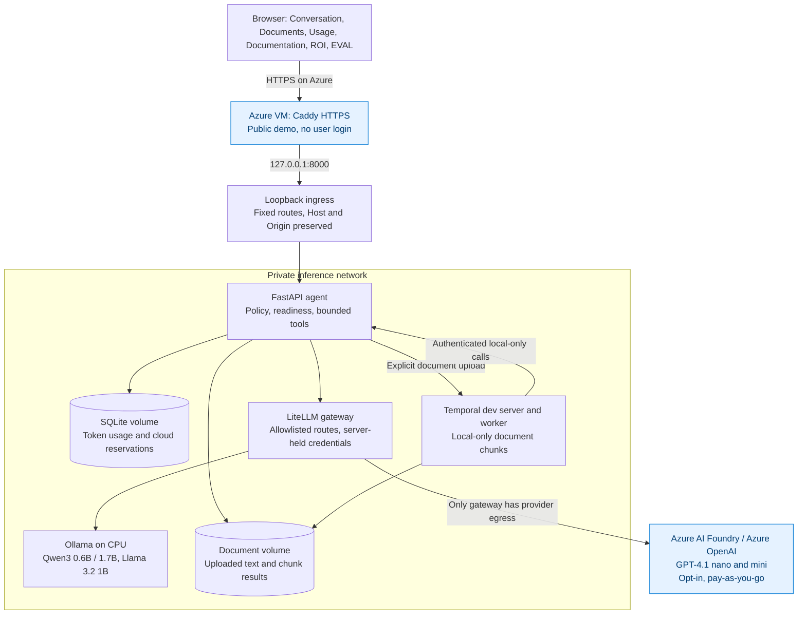
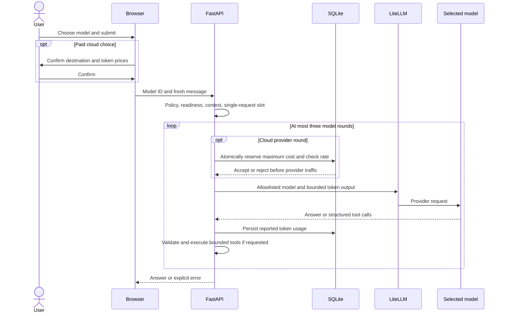
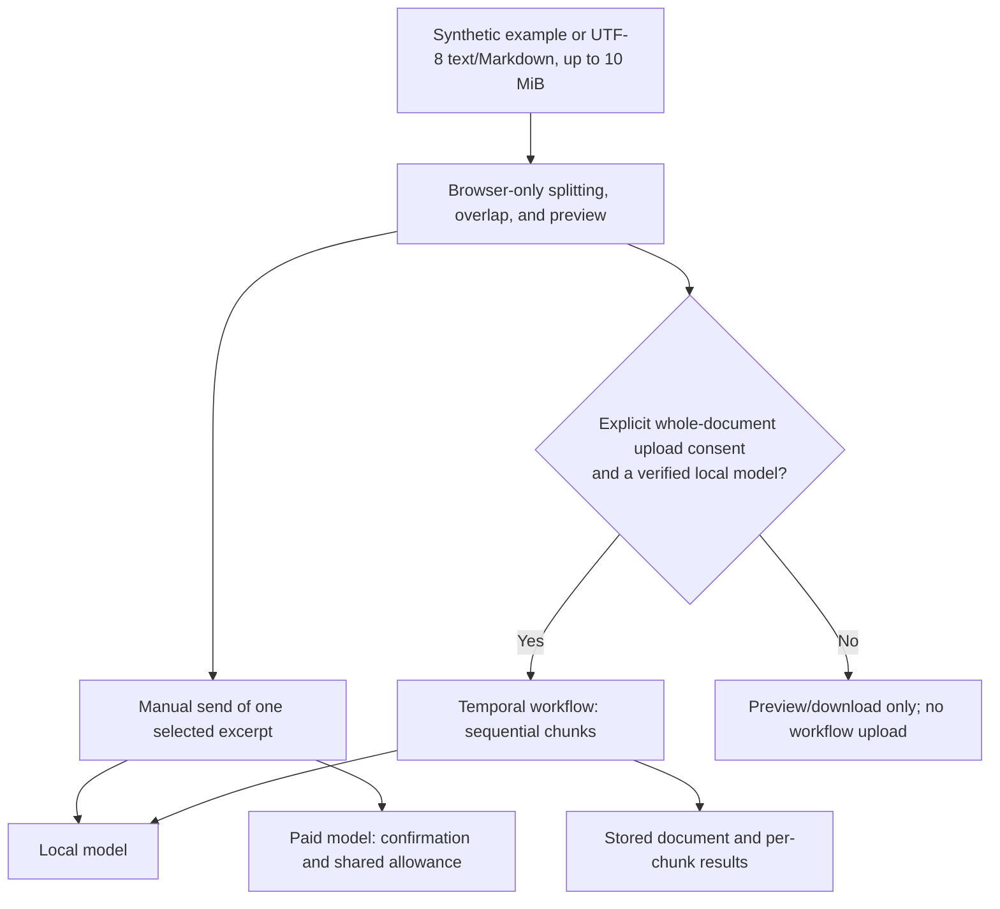

## TL;DR and business reason

Compare local and lower-cost cloud models before investing in a larger
automation rollout. Try support drafting, meeting actions, invoice extraction,
and calculation tasks using synthetic data. The ROI and EVAL tabs make financial
assumptions and output contracts visible instead of promising business results.

The top-of-page summary links to ROI, EVAL, and architecture. Architecture nodes
are keyboard-accessible links that open component details. Selecting a node or
opening these tabs does not submit inference.

The landing page puts the model selector and message composer before examples.
Expand "Try a prebuilt use case" to see all six examples; selecting one fills
and focuses the composer and closes the examples without sending a request.
Model readiness and technical specifications remain available under "Models &
technical details" in the sidebar. Privacy and spending notices stay separate.

## System overview

Workbench is a local-first, tool-calling application. The browser provides
Conversation, Documents, Token usage, Documentation, ROI, and EVAL tabs. Model selection
controls both the destination and the visual theme: local models use the green
workspace; paid cloud models use Azure blue. Selecting a model does not itself
submit inference.

The following diagram describes the hosted Azure development deployment.
Local development omits Caddy and connects directly to loopback ingress.
Azure AI Foundry routes are optional and disabled in the source catalog until
configured.



The canonical overview source is [architecture.mmd](./architecture.mmd).
Its generated [SVG](../agent/static/architecture.svg) is bundled with the agent
image and served through an explicitly allowlisted ingress path. The
Documentation tab needs no CDN, external rendering service, or runtime
JavaScript diagram dependency.

## ROI calculator and business assumptions

The ROI tab is browser-only. It does not call a model, read Azure bills, upload
inputs, or persist assumptions on the server. Its illustrative defaults are:

| Input | Default assumption |
| --- | ---: |
| Tasks per month | 200 |
| Manual minutes per task | 10 |
| AI-assisted minutes including review/rework | 6 |
| Loaded labor value, USD/hour | 30 |
| Adoption percentage | 50 |
| Monthly hosting and other operations, USD | 60 |
| Monthly token cost, USD | 5 |
| One-time setup/training, USD | 500 |

These are user-editable assumptions, not a measured pilot or an Azure quote.
The monthly token-cost assumption is separate from the site's daily reservation
allowance. Include support, monitoring, integration, and review/rework costs in
your own estimate.

```text
monthly_hours = tasks * adoption_percent / 100 * (manual_minutes - assisted_minutes) / 60
monthly_gross_value = monthly_hours * hourly_value
monthly_running_cost = hosting_and_operations + token_cost
monthly_net_value = monthly_gross_value - monthly_running_cost
first_year_cost = setup_cost + 12 * monthly_running_cost
first_year_net_value = 12 * monthly_gross_value - first_year_cost
first_year_ROI_percent = first_year_net_value / first_year_cost * 100
simple_setup_payback_months = setup_cost / positive_monthly_net_value
```

The defaults produce approximately 6.7 hours released per month, USD 200 gross
monthly capacity value, USD 135 monthly net value, USD 1,120 first-year net
value, and an 87.5% first-year ROI. Simple setup payback is about 3.7 months;
monthly operating break-even is 65 tasks and excludes setup recovery.
The calculator retains negative time savings and negative net value. Zero
first-year costs make ROI undefined, and nonpositive monthly net has no
positive payback. Invalid or blank inputs show an error rather than stale totals.

The comparison bars are clickable shortcuts to their assumptions, not extra
data sources. Their labels preserve negative values, while bar lengths show
nonnegative values only.

> [!IMPORTANT]
> Time released is capacity, not automatically cash savings. Validate whether
> staffing costs, spending, throughput, or revenue actually change. Use measured
> adoption, error/rework rates, and reviewer acceptance from a representative
> pilot. No ROI result is an investment recommendation or a guarantee.

## EVAL: synthetic model scorecard

### EVAL in plain English

Think of EVAL as a three-question quiz for the model you selected. The sample
data is made up, and the correct answers are known in advance. Code checks the
answers; another AI model does not judge them.

Choose a ready model in Conversation, open EVAL, then select Start 3 synthetic
checks. Paid cloud asks for approval before any test request is sent. Opening
the tab alone sends no inference requests.

Pass means the answer and format matched. Fail means the model replied but got
the answer or format wrong; later questions still run. Error means a check
could not finish, so remaining questions stop without automatic retries.
Not run means a question was skipped after Stop or an error, not that it passed.

A score of 3/3 means these three questions passed in this run. It does not mean
100% accuracy on other questions or approval for production. For example, `42`
passes the first check, while `The answer is 42.` fails because a program
expecting a number needs the correct format.

Open a result to inspect its question, expected answer, actual reply, and wait
time measured by the browser. Download the scorecard before reloading or
leaving, because results remain only in browser memory. Stopping waits for the
current request and does not undo charges. The paid allowance is shared by all
users, not granted separately to each person.

### Technical rules and limits

Scorecards use methodology `synthetic-smoke-v2` and record each check's tool mode.
The arithmetic checks allow validated tools. The JSON extraction check explicitly
uses `tool_choice: "none"`: no tool definitions are sent to the provider, and an
unsolicited tool call fails before execution. Both `/agent` and `/ui-api/agent`
accept this optional request field; the default `"auto"` preserves normal chat
and document-workflow behavior. Text-only requests retain the same model
readiness checks, usage accounting, cloud allowance, and rate limit.

EVAL is an explicit-run smoke test, not a broad quality, safety, fairness, or
security benchmark. Select a verified model in Conversation, open EVAL, and
choose Start 3 synthetic checks. Merely opening the tab runs nothing.

| Check | Required output contract |
| --- | --- |
| Arithmetic | Numeric-only answer equal to 42 for `6 * 7` |
| Discount | Numeric-only answer equal to 68 for `80 * (1 - 0.15)` |
| Ticket extraction | Exactly `ticket_id=DEMO-42`, `priority=high`, and `owner=Nia` in a standalone JSON object |

Numeric decimals such as `42.0` are accepted. Explanatory prose and currency
symbols fail the numeric-only contract. JSON key order is irrelevant, but
Markdown fences, extra keys, non-string values, or shortened identifiers fail.
The checks grade returned text, not a complete tool trace; the runtime has
separate calculator-based readiness checks.

Three fresh requests run sequentially against the selected model, with browser
round-trip latency measured per request. Each request can use multiple provider
rounds. Paid cloud requires confirmation of destination/prices before the run
and consumes the existing shared allowance and provider-call rate limit.
No fallback, automatic retry, or automatic spending-limit increase is used.

Every row reports pass, failed output contract, request/scoring error, or not
run. Failed output checks do not hide later results. Any request error, including
HTTP 429, stops remaining cases without retry. Stop after current check waits
for the current response, then skips remaining cases; it does not cancel server
work or undo charges. The score retains the denominator of all three cases and
separately reports errors and unrun cases.

Expand a row for its prompt, expected contract, answer/error, and observed
latency. Download the JSON scorecard to retain model identity, methodology
version, timestamps, case-level statuses, and answers. Results otherwise remain
in browser memory and disappear on reload. The scorecard is not a provider bill
and does not infer per-request token costs from shared global usage.

Before deployment, define representative domain datasets and acceptance
criteria, then measure reviewer acceptance, factual accuracy, privacy, fairness,
error/rework rates, failure recovery, actual cost, and repeated-run latency.
A three-case pass does not authorize production use or override model readiness
or the federal-review hold.

## Components and network boundaries

| Component | Responsibility | Persistence or access |
| --- | --- | --- |
| Browser | Model choice, examples, local splitting, and reporting | In-memory workspace; no provider keys |
| Caddy | Trusted public HTTPS for the Azure demo | TLS certificate volume; internal credential held server-side |
| Ingress | Fixed-destination route proxy | Loopback host port; no arbitrary upstreams |
| FastAPI | Policy, readiness, serialized requests, tool execution | Private network; agent and gateway credentials |
| LiteLLM | Allowlisted provider protocol translation | Provider keys; optional cloud egress |
| Ollama | One loaded local CPU model at a time | Named model-weight volume |
| SQLite | Reported usage and conservative cloud reservations | Existing usage volume |
| Temporal and worker | Sequential local-only document activities | Temporal development history and document volume |

### Component browser

The browser owns local document previews, ROI assumptions, and EVAL scorecards.
Explicit Send, workflow upload consent, or Start evaluation initiates processing.

### Component caddy

Caddy supplies public HTTPS and the server-held internal REST credential on the
Azure demo. It does not provide per-user authentication or isolation.

### Component ingress

The loopback ingress accepts a fixed route allowlist and never proxies arbitrary
destinations. It preserves Host, Origin, and authentication headers.

### Component agent

FastAPI enforces policy, model verification, context limits, one-at-a-time
inference, and bounded calculator/UTC tool execution.

### Component usage

SQLite durably records provider tokens and separate conservative cloud
reservations. Atomic reservations guard the shared allowance across processes.

### Component gateway

LiteLLM holds provider credentials and the optional provider-egress network.
It selects only allowlisted routes without automatic paid fallback.

### Component ollama

Ollama runs approved local models on CPU with a single loaded model. Readiness
requires approved digests, advertised tools, and a calculator round trip.

### Component temporal

The development Temporal server and worker process document chunks sequentially,
using only local models, with durable progress and explicit cancellation.

### Component documents

The document volume retains uploaded text, instructions, and chunk results.
Clearing the browser preview does not delete it or Temporal history.

### Component foundry

Azure AI Foundry provides the pinned, opt-in paid routes, subject to application
reservations and rate limits. Global Standard processing may leave the resource
region. The application allowance is not an Azure billing guarantee.

Only the gateway gets provider egress when the cloud overlay is enabled.
Ollama gets temporary download egress only during approved weight downloads.
The agent and Temporal services remain on the private network.

The deployed VM has 2 vCPUs and 8 GiB RAM; Ollama's container ceiling is 5 GiB.
The local-development baseline has different memory settings. CPU inference can
take minutes, and model switching can require loading weights again.

## Request lifecycle



Each message starts a fresh model context; displayed chat history is not resent.
The context check conservatively bounds UTF-8 bytes plus framing/tools within
4,096 tokens, including the 512-token output allowance. Conversations permit at
most three rounds and four tool calls. Tools are calculator and current UTC time.
The system does not automatically retry inference or fall back to a paid model.

Readiness requires an actual calculator round trip, not just endpoint liveness.
Local models additionally require an exact approved SHA-256 weight digest and
advertised tool capability. Failed or expired verification disables selection.
Cloud probes are approximately hourly; local verification uses the shorter
configured cycle.

## Paid models and spending controls

Azure requests disable parallel tool calling while retaining automatic tool
selection and all argument validation. The pinned GPT-4.1 nano `2025-04-14`
snapshot can emit multiple calls for the same tool when parallel calling is
enabled; see OpenAI's [function-calling guidance](https://developers.openai.com/api/docs/guides/function-calling#parallel-function-calling).
Local and other cloud providers keep their existing request parameters.

The hosted demo offers GPT-4.1 nano and GPT-4.1 mini through Azure OpenAI in
Azure AI Foundry. Global Standard deployments are in East US 2 and can process
requests outside that resource region. Deployment model versions are pinned
with automatic upgrades disabled.

| Model | Input USD / 1M tokens | Output USD / 1M tokens |
| --- | ---: | ---: |
| GPT-4.1 nano | 0.10 | 0.40 |
| GPT-4.1 mini | 0.40 | 1.60 |

Rates were checked against Azure retail pricing on 2026-10-24. Verify current
subscription pricing before enabling traffic. Local models have no cloud-token
charge but still use the hosting machine's compute.

The default application allowance is USD 1 per UTC day, shared across all
visitors, cloud routes, tool rounds, and verification probes. Each provider call
reserves:

```text
reservation in microdollars =
ceil(4096 * input_USD_per_million + 512 * output_USD_per_million)
```

This reserves 615 microdollars for nano or 2,458 for mini at the listed rates.
Reservations use a SQLite immediate transaction and persist before provider
traffic. They are never refunded, including failures, timeouts, and missing
usage reports. The shared rolling limit is six provider calls per minute,
not six conversations. A multi-round conversation can consume several calls.

Missing cloud prices or unavailable storage block calls. Exhaustion returns
HTTP 429; local models remain available. The remaining allowance is separate
from actual provider-reported tokens.

> [!WARNING]
> This is an application allowance, not an Azure billing guarantee. Direct key
> use, other applications, incorrect or changed prices, UTC billing boundaries,
> taxes, and VM/disk/network charges are outside the control. Azure budget alerts
> do not stop spending. Deleting the usage volume deletes reservations.

## Document processing and retention



Manual splitting uses 256 to 2,400 UTF-8 bytes per chunk and overlap no greater
than half the chunk size. It preserves code points and validates API request
size. Choosing a synthetic example does not upload it.

Automatic processing uploads the whole document only after consent. The server
validates and splits again, with at most 10,000 chunks. Temporal processing is
local-only even when cloud routes are enabled. Preserve the workflow ID to resume
monitoring; use explicit cancellation to stop further work.

Clear document removes browser state, not server artifacts, downloads, or a
running workflow. The usage database contains metadata and tokens, not prompts
or answers. Document storage contains uploaded text, instructions, and results;
Temporal retains workflow history. Back these volumes up separately and define
retention before using anything beyond synthetic development data.

## Build and run from source

Use Docker Engine and Compose v2 with Linux/amd64 images. Follow
[configuration and model approval](../README.md#prepare-configuration) to create
a private environment file, separate secrets, and an enabled catalog containing
only models you intend to install. Start with cloud processing off.

```bash
docker compose build
docker compose -f compose.yaml -f compose.bootstrap.yaml up -d ollama
docker compose exec ollama ollama pull qwen3:1.7b
```

Review the publisher, license, and full downloaded digest. Set the route's
approved digest, disable uninstalled models, then remove download egress:

```bash
docker compose up -d --force-recreate ollama
docker compose up -d gateway agent ingress
```

Open `http://localhost:8000`, or the configured agent port. Add
`compose.temporal.yaml` for optional workflows. For cloud routes, configure the
deployment endpoint, token prices, and gateway credential, explicitly enable
cloud processing, and include `compose.cloud.yaml`. See the
[cloud setup](../README.md#enable-external-models-explicitly).

The Azure-specific overlay is generated privately for that deployment.
Operations on the existing VM must retain all enabled overlays:

```bash
sudo -i
cd /opt/intel-agent
docker compose -f compose.yaml -f compose.cloud.yaml -f compose.temporal.yaml -f compose.azure.yaml ps
docker compose -f compose.yaml -f compose.cloud.yaml -f compose.temporal.yaml -f compose.azure.yaml logs --tail 50
```

Restart policies and named volumes persist across VM restarts. There is no
automatic independent backup or high availability. The Temporal development
server is not a production Temporal cluster.

## Build the Mermaid overview

Node.js 22.13 or newer is needed only to regenerate the checked-in SVG, not to
run the application. The Mermaid CLI version and dependency tree are locked.

```bash
npm ci
npm run docs:diagrams
```

The CLI normally uses Puppeteer's managed browser. If using an existing browser,
set `PUPPETEER_SKIP_DOWNLOAD=true` before installation and pass a local Puppeteer
configuration containing its executable path:

```bash
npm run docs:diagrams -- --puppeteerConfigFile PATH_TO_LOCAL_CONFIG
```

The build uses repository-owned Mermaid source with hyperlink support enabled,
rejects scripts, event-handler attributes, and unexpected destinations, and
requires all ten links to be internal component links. It rewrites those links
to application fragments and embeds the generated SVG between the architecture
markers in the UI. Do not embed untrusted Mermaid or SVG through this build.

Edit the canonical overview source and matching Mermaid block in this document,
regenerate the SVG, and run the focused tests. No source is sent to an external
diagram-rendering service.

```bash
uv run pytest tests/test_local_ui.py tests/test_ingress.py
node --test tests/test_documents.mjs
uv run ruff check agent gateway
uv run mypy agent gateway
```

## API and troubleshooting

| Endpoint | Purpose |
| --- | --- |
| `GET /healthz` | Process liveness |
| `GET /readyz` | At least one verified local model |
| `GET /models` | Routes, readiness, token prices, and shared cloud allowance |
| `POST /agent` | A fresh message with an allowlisted model ID |
| `GET /usage?scope=chat` | Reported usage, filtered to chat |
| `/document-workflows` | Local-only upload, progress, results, and cancellation |
| `GET /architecture.svg` | Bundled Mermaid-generated diagram |

Local REST requires a bearer token. Loopback UI requests use the same backend
with Host/Origin checks. The public Azure proxy supplies the internal REST
credential at the owner's request; this does not provide per-user identity.

HTTP 429 can mean active inference, a cloud rate limit, or exhausted allowance.
Read the response detail rather than automatically retrying. HTTP 503 can mean
unverified models, missing cloud prices, or unavailable storage. HTTP 502/504
can indicate provider, gateway, model, or timeout failures. Inspect the relevant
service logs without publishing credentials or document content.

## Development-only safety boundary

> [!WARNING]
> The hosted demo is public without login. Anyone can consume its shared
> allowance, submit document jobs, or read shared results. Origin checking is not
> authentication. Use only public or synthetic data. This is not an authorized
> environment for federal nonpublic information, CUI, or classified material.

The separate federal-review profile blocks processing before buffering request
bodies. Neither blue styling, readiness checks, nor the documentation overrides
that hold. Production requires separately reviewed identity, authorization,
data retention, encryption/key management, monitoring, backups, and deployment
approval. Always review model output for errors.
