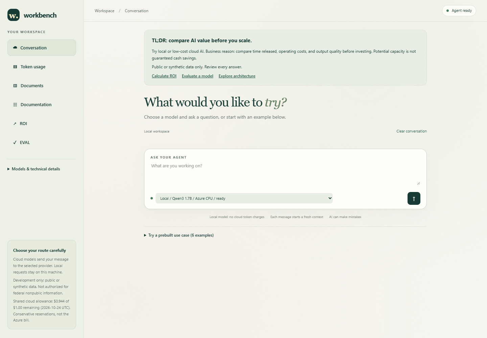
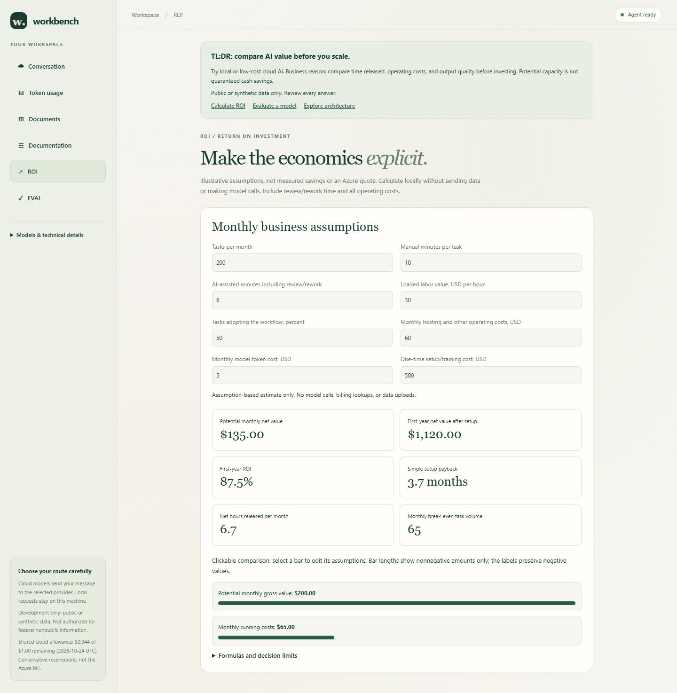
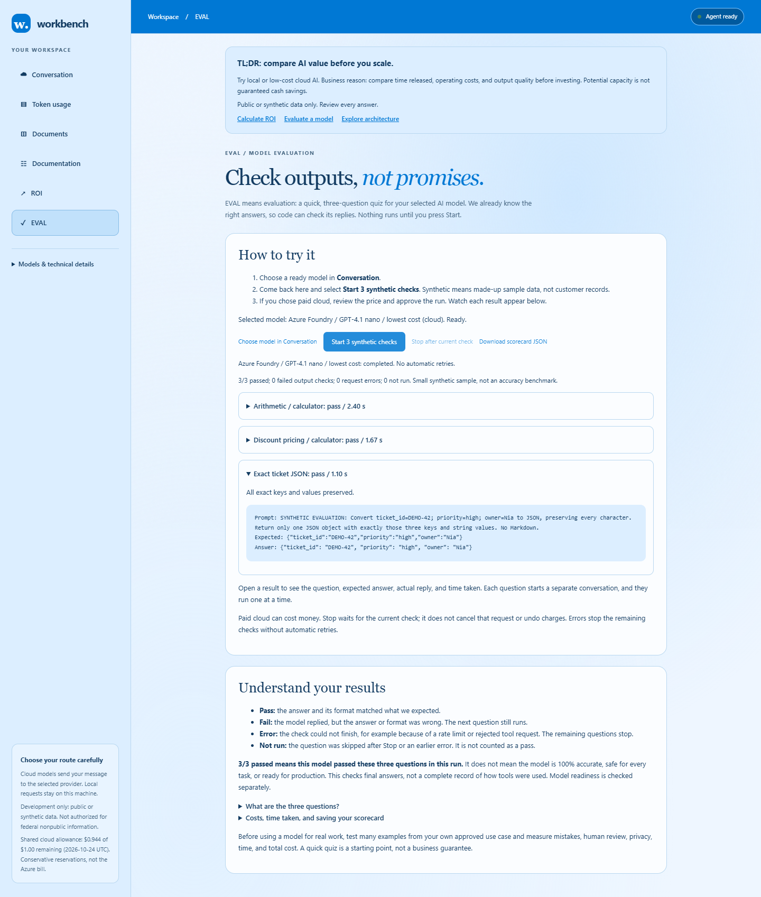
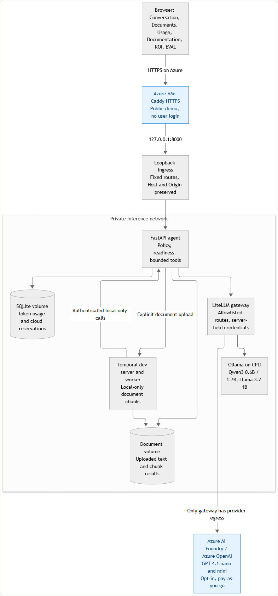
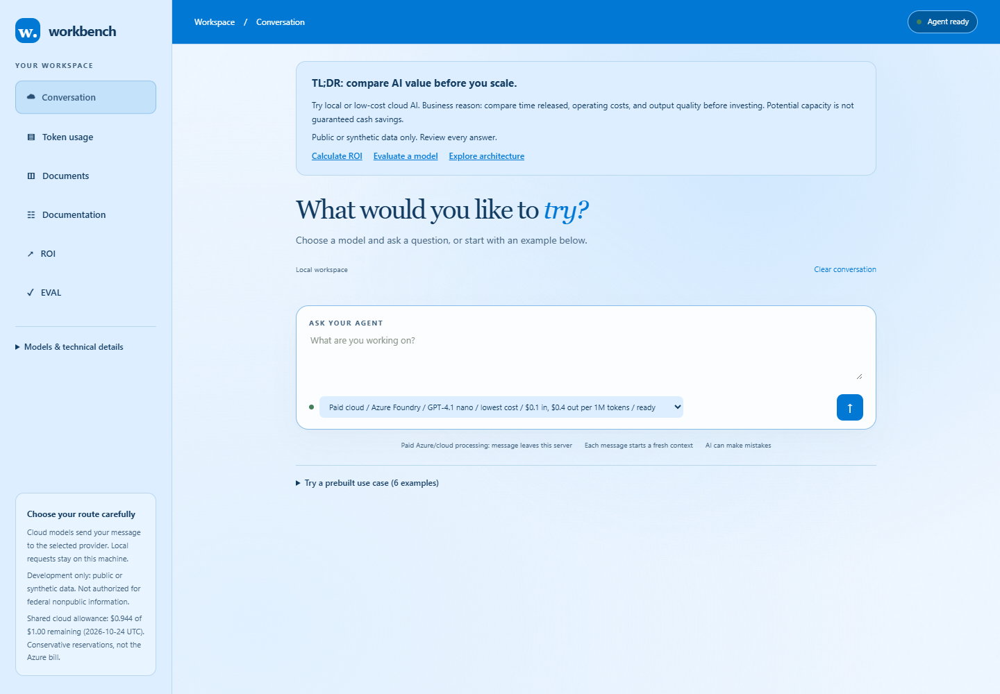

## What you will build

An Ubuntu Azure VM running Docker Compose, the web workbench, local model
inference, token accounting, and optional Temporal document processing. Start
with private access through an SSH tunnel. Public HTTPS and paid Azure AI
Foundry models are separate, optional steps.

This is a single-host development demo, not a production or high-availability
deployment. Use public or made-up data only. It is not approved for federal
nonpublic information.



## Before you begin

- An Azure subscription with permission to create a VM, disk, public IP, and
  network security group. Check your regional VM quota and current pricing.
- An SSH client and an SSH key you control. On Windows, use the built-in
  OpenSSH client; do not upload your private key to this repository.
- Review the licenses for Qwen3 and Llama 3.2 before downloading their weights.
- Allow time for image builds and multi-gigabyte model downloads.

The commands below run in **Bash on the Ubuntu VM**, unless a step says to run
them on your own computer. Do not paste Bash commands directly into PowerShell.
For Windows users, the `ssh` commands themselves work in PowerShell.

VMs, managed disks, public IPs, and network traffic incur Azure charges.
Set an Azure budget alert, but remember that alerts do not stop spending.
The application's US$1/day allowance covers configured cloud-model calls,
not VM hosting or your entire Azure bill.

## Step 1: Create a dedicated resource group and VM

In the [Azure portal](https://portal.azure.com/):

1. Open **Virtual machines**, then **Create > Azure virtual machine**.
2. Choose your subscription and create a new resource group, such as
   `rg-intel-agent-demo`. Use a dedicated group so cleanup will not affect
   unrelated resources.
3. Name the VM `intel-agent-vm` and choose a region with available quota.
4. Select **Ubuntu Server 24.04 LTS**, x64 architecture.
5. For this full walkthrough, choose a size with at least **4 vCPUs and
   16 GiB RAM**, such as `Standard_D4as_v5` if available. This gives image
   builds and Temporal more headroom. The hosted demo uses a smaller,
   separately memory-tuned 2-vCPU/8-GiB VM; do not assume this walkthrough's
   default container limits fit that smaller VM.
6. Choose **SSH public key** authentication and username `azureuser`.
   Use your own public key or download and safely store the generated
   private key when Azure offers it. Never commit that key.
7. Choose a **128 GiB Standard SSD** OS disk.
8. In Networking, allow SSH TCP **22** only from your administrator public
   IP address, using a `/32` source range. Leave application ports closed.
   Do not expose ports 8000, 4000, 11434, or 7233.
9. Review the estimated charges, then create the VM.
10. Record its public IP. Open its public IP resource and configure a unique
    **DNS name label** if you plan to add HTTPS later.

Expected result: the VM is running, SSH is restricted to your IP, and no
application endpoint is publicly exposed.

## Step 2: Connect and install Docker

On your own computer, use the VM's **Connect > Native SSH** instructions.
For example, replace both placeholders before running:

```text
ssh -i YOUR_PRIVATE_KEY_PATH azureuser@YOUR_VM_PUBLIC_IP
```

Run the following inside the VM's Ubuntu shell:

```bash
sudo apt-get update
sudo apt-get install -y docker.io docker-compose-v2 git python3 python3-yaml
sudo systemctl enable --now docker
sudo docker version
sudo docker compose version
```

If your Ubuntu image does not offer these packages, use the official
[Docker Engine installation instructions](https://docs.docker.com/engine/install/ubuntu/)
instead. The project requires Compose v2.

If SSH times out, check the VM state, public IP, and NSG source range first.
Your public IP may have changed. Do not solve this by opening SSH to everyone.
Azure Bastion is another access option, with separate costs.

## Step 3: Clone the source and create private settings

Use a root shell for the remaining deployment commands. This keeps the
application settings restricted to the administrator:

```bash
sudo -i
umask 077
git clone https://github.com/KrishnaDistributedcomputing/multi-llm-intel-agent.git /opt/intel-agent
cd /opt/intel-agent
cp .env.example .env
chmod 600 .env
python3 -c "import secrets; print(secrets.token_urlsafe(32)); print(secrets.token_urlsafe(32))"
nano .env
```

Set `AGENT_API_KEY` to the first generated value and `LITELLM_MASTER_KEY` to
the second. Keep them different. Leave:

```dotenv
ALLOW_CLOUD=false
ACR_LOGIN_SERVER=
IMAGE_TAG=0.1.0
AGENT_PORT=8000
CLOUD_DAILY_BUDGET_USD=1
CLOUD_CALLS_PER_MINUTE=6
```

Keep provider keys empty for now. `PUBLIC_HOST` is only needed in Step 9.
Do not copy this VM's private settings into GitHub. Docker administrators can
inspect container environments, so only trusted administrators should manage
this host.

## Step 4: Choose the three smaller local models

Edit the catalog:

```bash
nano models.yaml
```

Set `enabled: true` only for these local route IDs:

| Route ID | Download name | Purpose |
| --- | --- | --- |
| `local-qwen3-small` | `qwen3:1.7b` | General local option |
| `local-qwen3-tiny` | `qwen3:0.6b` | Smaller local option |
| `local-llama32-small` | `llama3.2:1b` | Alternative model family |

Set all other routes to `enabled: false`, including `local-qwen3` (4B) and
all cloud routes. Keep the supplied full `approved_digest` values for the
three selected models. Do not replace them with abbreviated IDs.

At least one local route must remain enabled. Each selected model must later
match its approved digest and pass a real calculator round trip before it
appears as a ready choice.

## Step 5: Build images and download weights

From `/opt/intel-agent`, still in the root shell:

```bash
docker compose build
docker compose -f compose.yaml -f compose.bootstrap.yaml up -d ollama
docker compose exec ollama ollama pull qwen3:1.7b
docker compose exec ollama ollama pull qwen3:0.6b
docker compose exec ollama ollama pull llama3.2:1b
docker compose run --rm --no-deps --entrypoint python gateway \
  -c "import urllib.request; print(urllib.request.urlopen('http://ollama:11434/api/tags').read().decode())"
```

Compare each downloaded model's full digest with its `approved_digest` in
`models.yaml`, after normalizing the optional `sha256:` prefix. If a tag now
points to different weights, stop and review the source, license, and new
digest. Do not automatically approve a mismatch.

Remove the temporary download network, then start the application and Temporal:

```bash
docker compose up -d --force-recreate ollama
docker compose -f compose.yaml -f compose.temporal.yaml config --quiet
docker compose -f compose.yaml -f compose.temporal.yaml up -d --build
docker compose -f compose.yaml -f compose.temporal.yaml ps
```

Do not leave `compose.bootstrap.yaml` enabled for normal operation. Local
inference does not need provider egress.

## Step 6: Check health and model readiness

```bash
curl --fail http://127.0.0.1:8000/healthz
curl --fail http://127.0.0.1:8000/readyz
docker compose -f compose.yaml -f compose.temporal.yaml logs --tail 60 agent
```

`healthz` reports whether the service is alive. `readyz` can return HTTP 503
while models load or verification runs. CPU checks can take several minutes.
Do not bypass readiness or digest validation to make a failed model selectable.

Expected result: containers are running, readiness eventually succeeds, and
the UI lists the selected models as ready. If a candidate fails tool inference,
inspect its reason and leave it unavailable.

## Step 7: Open the private web interface

On your own computer, open a second terminal and keep this SSH tunnel running:

```text
ssh -i YOUR_PRIVATE_KEY_PATH -L 8000:127.0.0.1:8000 azureuser@YOUR_VM_PUBLIC_IP
```

Open [http://localhost:8000](http://localhost:8000). Use `localhost`, not
`YOUR_VM_PUBLIC_IP:8000`. The website itself does not ask for a username or
password; access is restricted by your SSH tunnel. If local port 8000 is
occupied, use `-L 8001:127.0.0.1:8000` and open `http://localhost:8001`.


## Step 8: Try the features

1. In Conversation, choose a ready local model. Expand **Try a prebuilt use
   case**, select an example, review it, then Send. Selecting an example alone
   makes no inference request.
2. In Documents, load a synthetic example. Splitting and previewing stay in
   the browser. Manual Send uploads one chunk. A Temporal run uploads and
   retains the whole document after consent; it uses local models only.
3. In ROI, change the assumptions. The default example shows potential monthly
   net value of **US$135**, first-year net value of **US$1,120**, and **87.5%**
   first-year ROI. These are illustrative calculations, not measured savings.
4. In EVAL, select Start to run three synthetic checks. It tests answers of
   `42`, `68`, and exact ticket JSON. Pass means the answer and format matched;
   Error means the request could not finish. Errors stop remaining checks
   without automatic retries. A 3/3 pass is not an overall accuracy rating.
5. In Documentation, select a component in the architecture graphic to open
   its details. In Token usage, inspect reported tokens and call history.





The EVAL screenshot uses the explicitly approved paid nano route in the hosted
demo. Your initial private deployment is local-only; complete Step 10 before
trying those paid choices. Test outcomes and latency can change between runs.



## Step 9: Optional public HTTPS without a website login

Skip this step to keep the deployment private.

> [!WARNING]
> This option intentionally makes the site and API public without user accounts.
> Anyone can run inference, consume the shared paid allowance, submit document
> jobs, and access shared results and usage. There is no per-user isolation.
> Origin checks are not authentication. Use only a disposable public demo with
> synthetic data; do not expose confidential documents or a production workload.

The supplied [HTTPS overlay](../compose.https.yaml) runs Caddy on the Linux VM's
host network. The [Caddy configuration](../Caddyfile) terminates TLS and forwards
to loopback ingress. It injects the internal REST bearer on the server, not into
the browser. Only the exact public HTTPS Origin is translated to the application's
loopback Origin; other browser origins are left unchanged and rejected.

1. Confirm that the VM public IP has a DNS name, such as
   `YOUR_UNIQUE_LABEL.westus2.cloudapp.azure.com`, resolving to that VM.
2. In `.env`, set `PUBLIC_HOST` to that DNS name only: no `https://`, path, or
   trailing slash. Keep `AGENT_PORT=8000` for this Caddy configuration.
3. In the Azure NSG, allow inbound TCP 80 and 443 for certificate issuance and
   HTTPS. Keep SSH restricted and all inference/Temporal ports closed.
4. Run:

   ```bash
   docker compose -f compose.yaml -f compose.temporal.yaml -f compose.https.yaml config --quiet
   docker compose -f compose.yaml -f compose.temporal.yaml -f compose.https.yaml up -d
   docker compose -f compose.yaml -f compose.temporal.yaml -f compose.https.yaml logs --tail 40 https
   ```

5. Open `https://YOUR_DNS_NAME` and check the certificate and model selector.
   Caddy keeps certificates in named volumes. If issuance fails, check DNS,
   ports 80/443, competing host services, and Caddy's logs.

Do not add direct public port mappings to the agent, gateway, Ollama, or Temporal.
The hosted demo uses the same proxy boundary; its existing deployment-specific
overlay is not replaced by this walkthrough.

## Step 10: Optional paid Azure AI Foundry models

Keep local-only mode if you do not want provider charges.

1. In Azure AI Foundry/Azure OpenAI, create an appropriate resource in a region
   with quota. The reference deployment uses **East US 2** and **Global Standard**.
   Review data-residency and current pricing before creating deployments.
2. Create deployments named `ai-gpt41-nano` for GPT-4.1 nano and `ai-gpt41-mini`
   for GPT-4.1 mini. The reference uses model version `2025-04-14` with automatic
   version upgrades disabled. If that version is unavailable, stop and review
   a supported replacement, prices, and compatibility instead of substituting
   silently.
3. In `models.yaml`, enable the `azure` and `azure-mini` routes. Set `api_base`
   on both to your resource's HTTPS endpoint. Keep the `azure/DEPLOYMENT_NAME`
   model values aligned with your actual deployment names. The supplied
   `api_version` is `2024-10-21`.
4. Verify and update both routes' input/output prices. The dated reference
   prices and billing caveats are in the
   [Foundry configuration guide](../README.md#lower-cost-azure-ai-foundry-choices).
5. In the private `.env`, set `AZURE_API_KEY`, `ALLOW_CLOUD=true`,
   `CLOUD_DAILY_BUDGET_USD=1`, `CLOUD_CALLS_PER_MINUTE=6`, and
   `CLOUD_VERIFY_INTERVAL_SECONDS=3600`. Do not commit the key or put it in
   the browser.
6. Use the cloud overlay in every subsequent Compose command:

   ```bash
   docker compose -f compose.yaml -f compose.temporal.yaml -f compose.cloud.yaml up -d --force-recreate gateway agent
   ```

   If public HTTPS is enabled, also include `-f compose.https.yaml`.
   That overlay is additive; do not recreate the inference stack without its
   cloud configuration after enabling paid routes.

7. Wait for tool verification. Select a ready paid model; the workspace turns
   Azure blue. Review the confirmation before sending a prompt or starting EVAL.



The allowance is shared across all visitors and paid models, not US$1 per user.
Every provider round, including readiness checks and failed calls, reserves
allowance. Three EVAL questions can require more than three provider calls.
HTTP 429 can mean an exhausted allowance or the rolling rate limit.
The app does not raise limits, retry automatically, or switch providers.
Azure budget alerts and this app's allowance are not a hard cap on the Azure bill.

## Step 11: Update, troubleshoot, and preserve data

Before updating, back up `.env`, your reviewed `models.yaml`, and the persistent
volumes to a private location. Record the currently deployed Git commit:

```bash
cd /opt/intel-agent
git rev-parse HEAD
git status --short
```

The catalog is intentionally customized in Step 4. Preserve its local changes
before pulling; do not use a hard reset or overwrite it with defaults. After
reconciling your catalog and settings with the new source, use `git pull --ff-only`.
If it reports divergence or conflicting local changes, stop and review them.

Rebuild and restart with the same overlays you chose:

```bash
docker compose -f compose.yaml -f compose.temporal.yaml build
docker compose -f compose.yaml -f compose.temporal.yaml up -d
docker compose -f compose.yaml -f compose.temporal.yaml ps
```

Add `compose.cloud.yaml` and/or `compose.https.yaml` to **all three commands**
when enabled. Recheck health, model readiness, a synthetic calculator prompt,
and the UI before considering the update complete. Container recreation retains
named volumes; they are on the VM disk and are not independent backups.

| Symptom | First checks |
| --- | --- |
| Build fails or VM becomes unresponsive | Free disk/RAM, image-build logs, and chosen VM size |
| Model absent or not ready | Enabled flag, downloaded full digest, tool capability, agent logs |
| Browser request rejected | Use localhost through the tunnel, or the exact configured HTTPS hostname |
| Public HTTPS unavailable | DNS, NSG 80/443, Caddy logs, and host port conflicts |
| Cloud HTTP 429 | Remaining shared UTC-day allowance and six-provider-call/minute limit |
| EVAL Fail | Inspect the answer and required format; do not treat it as a transport error |
| EVAL Error | Inspect the error; remaining checks stop and no automatic retry is made |

## Step 12: Stop charges or remove the demo

Stopping Docker containers alone does not stop VM compute billing.
In Azure portal, stop the VM and confirm its state is **Stopped (deallocated)**.
Managed disk and public IP charges can continue.

Before deletion, export any needed data. Delete only the dedicated resource group
created in Step 1 if you intend to permanently remove its VM, disk, networking,
and stored data. Foundry resources created in another group must be managed
separately. Do not delete a shared resource group.

## More detail

- [Architecture, Mermaid diagrams, ROI formulas, EVAL rules, and operations](architecture.md)
- [Local development and validation](../README.md#development-and-validation)
- [Docker Engine on Ubuntu](https://docs.docker.com/engine/install/ubuntu/)
- [Azure VM SSH troubleshooting](https://learn.microsoft.com/troubleshoot/azure/virtual-machines/linux/troubleshoot-ssh-connection)
